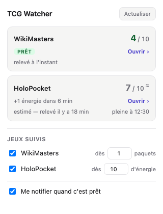

# TCG Watcher

Extension Chrome/Brave qui surveille ce qui est disponible sur [WikiMasters](https://www.wiki-masters.com/) et [HoloPocket](https://holopocket.fr/) : le total s'affiche sur l'icône, et une notification part quand le seuil est atteint.



| Site | Ce qui est compté | Pourquoi |
| --- | --- | --- |
| WikiMasters | paquets disponibles (`x / 10`) | un paquet = une ouverture |
| HoloPocket | énergie (`x / 10`) | chaque booster coûte un montant d'énergie différent selon l'extension, l'énergie est la seule mesure stable |

L'extension lit uniquement ces deux sites, ne communique avec aucun serveur, et conserve tout en local dans le navigateur.

## Installation

Elle n'est pas publiée sur le Chrome Web Store : l'installation se fait depuis les sources.

1. Télécharger ce dépôt (`git clone`, ou **Code → Download ZIP** puis décompresser)
2. Ouvrir `brave://extensions` (ou `chrome://extensions`)
3. Activer le **Mode développeur**, en haut à droite
4. Cliquer **Charger l'extension non empaquetée** et choisir le dossier du dépôt

L'icône apparaît dans la barre d'outils ; l'épingler permet de garder le badge visible. Il faut être connecté aux sites dans ce navigateur pour que les relevés fonctionnent.

Testée sur Brave et Chrome, sur macOS. Aucune dépendance : rien à installer, rien à compiler.

## Fonctionnement

Trois niveaux, du moins coûteux au plus coûteux :

1. **Projection** — entre deux relevés, l'extension calcule l'état courant à partir du rythme de recharge. Aucun réseau, aucun onglet, badge à jour chaque minute. La cadence est apprise en comparant deux relevés successifs (mesurée à ~10 min par paquet et par point d'énergie sur les deux sites), avec repli sur 10 min tant qu'aucune mesure n'est disponible.
2. **Onglet déjà ouvert** — si un onglet du site existe quelque part, son content script est interrogé directement.
3. **Onglet épinglé éphémère** — en dernier recours seulement, toutes les 5 minutes et uniquement si le dernier relevé a plus de 4 minutes. Il est `pinned` (réduit à une vignette), chargé en arrière-plan, puis refermé.

Un verrou garantit qu'**un seul relevé tourne à la fois** : sans lui, deux déclencheurs rapprochés ouvrent chacun leur onglet sur le même site et se gênent. Les onglets créés par l'extension sont identifiés et persistés, pour ne jamais être confondus avec ceux de l'utilisateur et pour être refermés même si le service worker est tué en plein relevé.

### Pourquoi le popup ne parle pas au service worker

Un relevé peut durer une quinzaine de secondes, le temps qu'une page s'hydrate. Or un service worker MV3 ne traite **qu'un message à la fois** : tout message envoyé pendant ce relevé attend son tour, y compris celui d'un popup qu'on vient d'ouvrir — la fenêtre reste alors figée.

À l'ouverture, le popup ne lit donc que le storage local et n'envoie aucun message. Les relevés sont portés par les alarmes, la projection comble l'intervalle, et le bouton **Actualiser** reste disponible pour forcer une lecture.

Pour la même raison, une lecture vide (page pas encore hydratée, `available: null`) n'est jamais stockée : elle effacerait un relevé valide.

Un simple `fetch` ne suffit pas : les deux sites sont des SPA qui rendent leur compteur côté client, et aucun endpoint JSON ne l'expose (vérifié : seul `/api/notifications` existe sur WikiMasters). Le HTML servi ne contient pas la valeur.

### Projection et multi-appareils

La recharge étant garantie par le temps, la projection ne peut que **monter**, et elle est plafonnée à la capacité. En revanche, des paquets ouverts sur un autre appareil sont invisibles : l'estimation est donc une **borne haute**, corrigée au relevé réel suivant.

Deux conséquences assumées :
- un chiffre projeté est marqué `≈` dans le popup, avec « estimé » et l'âge du dernier vrai relevé ;
- **aucune notification ne part sur une projection** — seulement sur un relevé confirmé.

Le dernier relevé est conservé entre deux sessions, avec son horodatage. Un relevé qui n'a pas pu être rafraîchi est marqué « périmé ».

### Diagnostic

Le service worker trace chaque relevé, préfixé `[TCG]` : `brave://extensions` → lien **service worker** sur la carte de l'extension. On y voit quel site est relevé, par quel moyen, et pourquoi une lecture échoue.

### Badge

Le badge affiche le **total** des jeux suivis :

| Couleur | Sens |
| --- | --- |
| Rouge `#9f1239` | au moins un jeu suivi n'a pas atteint son seuil |
| Vert `#166534` | **tous** les jeux suivis ont atteint leur seuil |
| Gris `#3f3f46` | aucun jeu suivi, ou aucun relevé |

Texte blanc sur les trois fonds, tous au-dessus du ratio AA (8:1, 7:1 et 10:1). Le détail par jeu est dans l'infobulle au survol, les unités n'étant pas comparables d'un site à l'autre.

### Jeux suivis

Chaque jeu s'active ou se désactive dans le popup, avec son propre seuil. Un jeu désactivé est entièrement ignoré : pas de relevé, pas d'onglet ouvert, pas de notification, et il ne compte ni dans le total ni dans la couleur du badge.

### Notifications

Une notification part quand un site atteint son seuil, puis ne se répète pas tant que le compteur n'est pas redescendu en dessous — pas de spam. Un clic ouvre directement la page concernée.

Seuils par défaut : **1 paquet** sur WikiMasters, **10 d'énergie** sur HoloPocket (de quoi ouvrir un booster du Set de Base). Modifiables dans le popup.

## Structure

```
manifest.json
src/
  background.js          service worker : relevés, badge, notifications
  popup.html/.css/.js    interface du popup
  shared/
    state.js             projection, cadence, badge, réglages — partagé
                         entre le service worker et le popup
  sites/
    watcher.js           helpers de lecture DOM, injectés dans les pages
    wikimasters.js       lecteur WikiMasters
    holopocket.js        lecteur HoloPocket
icons/                   icônes générées
tools/
  make-icons.mjs         régénère les PNG
  test-*.mjs             tests du module partagé
```

`shared/state.js` contient la projection, la cadence, la logique de badge et les réglages, en un seul exemplaire. C'est volontairement un **script classique** exposant l'objet `TcgState`, chargé par `importScripts` dans le service worker et par une balise `<script>` dans le popup.

En faire un module ES serait plus idiomatique, mais un module est toujours différé : le popup devrait charger son script puis résoudre l'import avant d'afficher quoi que ce soit, ce qui retarde visiblement son ouverture. Le popup inclut aussi un gabarit statique dans le HTML, pour ne jamais s'ouvrir sur une fenêtre vide pendant la lecture du storage.

## Robustesse

Les deux sites sont des SPA avec des classes Tailwind générées, qui changent à chaque build. Les lecteurs s'ancrent donc sur le **texte visible** (« paquets disponibles », « / 10 d'énergie ») et non sur les classes CSS. Si un site change ses libellés, le popup affiche « compteur introuvable » plutôt que de mentir avec une vieille valeur.

## Développement

Les tests couvrent la projection, la cadence apprise, la couleur du badge, le verrou de relevé et les parseurs. Ils ne demandent que Node, sans dépendance :

```bash
for t in tools/test-*.mjs; do node "$t"; done
```

Régénérer les icônes :

```bash
node tools/make-icons.mjs
```

Après modification, recharger l'extension depuis `brave://extensions`.

## Avertissement

Projet personnel, sans lien avec WikiMasters ni HoloPocket. Il lit les pages de ces sites telles qu'elles s'affichent dans le navigateur, au même titre que leur utilisateur : aucun accès à leurs API privées, aucune automatisation du jeu lui-même. Un changement de leur interface peut le casser du jour au lendemain — dans ce cas, le popup affiche « compteur introuvable » plutôt qu'une valeur erronée.

## Licence

GNU GPL v3 — voir [LICENSE](LICENSE). Toute version modifiée et redistribuée doit également être publiée sous GPL, sources comprises.
